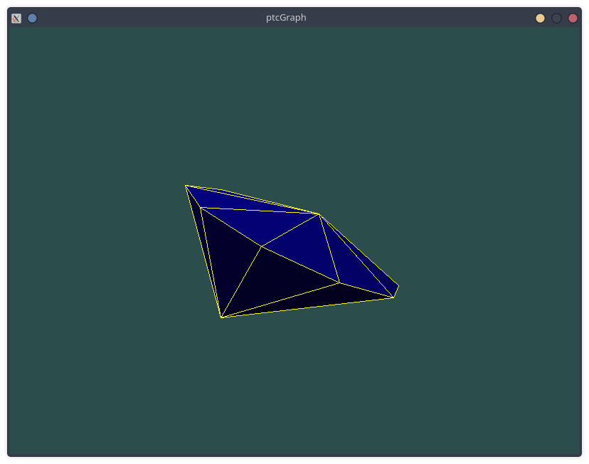

# ptcGraph examples

Examples for the *ptcGraph* unit, made by me or by others.



## Contents

| Folder | Description |
|---|---|
| [3d](3d) | 3D: rotating box, object loaded from a file, rotating pyramid. |
| [agg](agg) | Using the AggPas 2D graphics library with *ptcGraph*. |
| [bitmap](bitmap) | Loading BMP, GIF and PNG images; tools for the Windows 3.x icon format ([win3-icon](bitmap/win3-icon)). |
| [colornames](colornames) | Table of 256 named colors, and a program writing color constants for 64k or 16M color modes. |
| [drawings](drawings) | Animals and characters drawn with graphic primitives. |
| [faq](faq) | Answers to common questions: graphic modes, full screen, colors, PutImage… |
| [fractals](fractals) | Fractals and recursive figures: Mandelbrot set, Koch snowflake, Martin fractal… |
| [games](games) | Games, see below. |
| [graphbits](graphbits) | Examples by Glenn Kentwell, ported to *ptcGraph*. |
| [lessons](lessons) | Exercises from Russian and Ukrainian Pascal courses (see [SOURCES.md](lessons/SOURCES.md)). |
| [tp6](tp6) | Examples from the Turbo Pascal 6.0 documentation, and Borland's *BGIDemo*. |
| [tutorial](tutorial) | Short examples of the procedures and functions of the *Graph* unit. |

The root folder contains other examples: animations, curves, a clock, a piano keyboard…

### Games

- [Arkanoid](games/arkanoid), by Kropochkina Lena
- [Ghost Invasion](games/ghost-invasion)
- [Lines](games/lines), by Nane Petrosyan
- [Maze](games/maze), by Randy Ding
- [Nacho](games/nacho): hangman and snake, by Nacho Cabanes
- [Pong](games/pong)
- [Push Balls](games/push-balls), a small Sokoban-like puzzle
- [Reversi](games/reversi), the QBasic game ported by RetroNick
- [Snake Lines](games/snake-lines)
- [Snake](games/snake-markus), by Markus Mangold
- [Sokoban](games/sokoban), by Yevhen Yevsyuhov

## Building

Each folder has its own *Makefile*. In most folders, to build an example, go to the folder and type `make` followed by the name of the program, without extension:

```
cd fractals
make mandelbrot2
```

Most examples are a single file that only needs *ptcGraph*.

## See also

- [Baby Chess](https://github.com/rchastain/baby-chess)
- [Cairo examples](https://github.com/rchastain2/cairo-examples/tree/main/pascal/ptcgraph)
- [Fiveline](https://github.com/RetroNick2020/fiveline)
- [Ghost Invasion (Pac-Man clone)](games/ghost-invasion)
- [Kwirk (The Quest of Kwirk's Castle)](https://github.com/pascaldragon/kwirk)
- [Russian Checkers](https://github.com/rchastain/pascal-russian-checkers)
- [SMFONTS (bitmap fonts by Remco de Korte)](https://codeberg.org/rchastain/smfonts)
- [Snake for ptcGraph](https://codeberg.org/rchastain/snake-ptcgraph)
